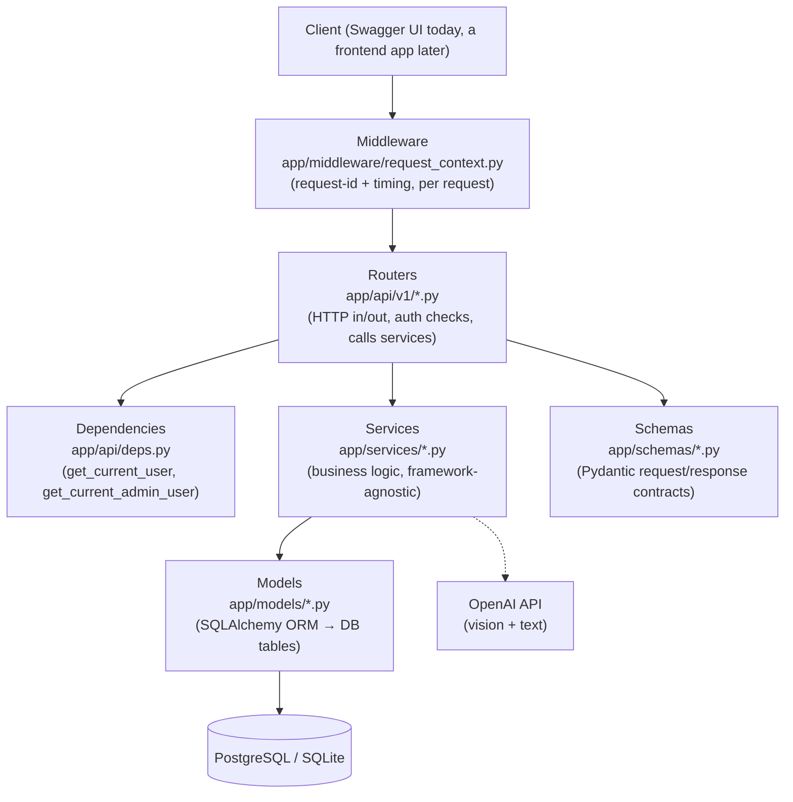
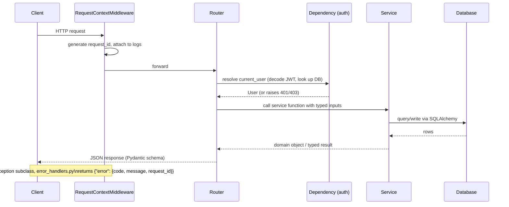
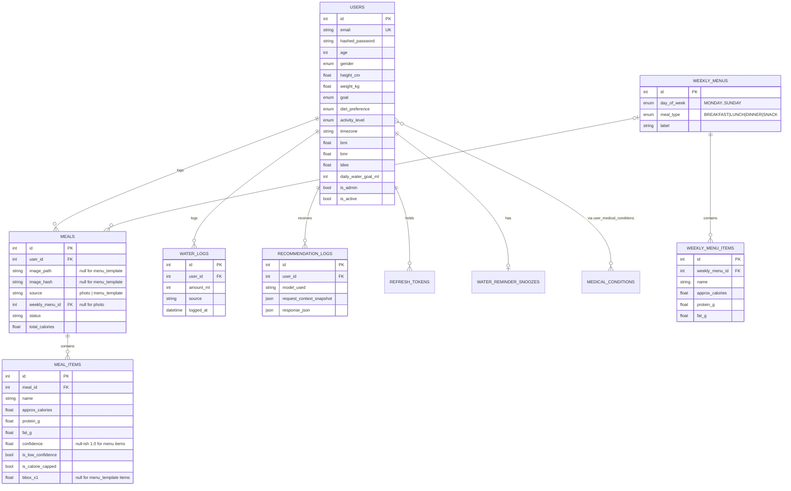
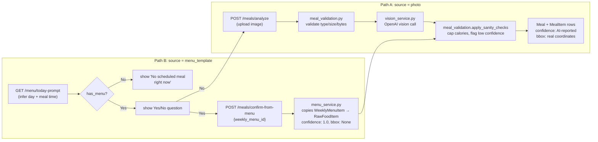

# Architecture

This document explains how the AI Food Agent backend is put together: the layers,
the database schema, the two ways a meal gets logged, the auth model, and the
reasoning behind the less-obvious design decisions. It's aimed at anyone building a
frontend against this API, or picking up backend work on it later.

For setup/run instructions, see [README.md](./README.md).

## 1. Layered architecture



**Why split it this way:** `models/` (DB shape) is kept separate from `schemas/`
(API contract) so ORM internals never leak through responses — e.g. `MealItem.bbox_x1`
(a raw DB column) becomes `bounding_box: [x1, y1, x2, y2]` (a clean API field) only in
the schema layer. `services/` holds all business logic with no FastAPI imports,
which is what makes `health_metrics.py`, `water_goals.py`, and `meal_validation.py`
directly unit-testable without spinning up the app.

## 2. Request lifecycle

Every request passes through the same pipeline, regardless of endpoint:



`app/core/error_handlers.py` registers three handlers: one for the app's own
`AppException` hierarchy (`app/core/exceptions.py`), one for Pydantic validation
errors, and a catch-all for anything unexpected — so every error response has the
same envelope shape, never a raw traceback.

## 3. Database schema



Every table (except the `user_medical_conditions` join table) also carries a
`TimestampMixin` (`created_at`, `updated_at`) and an `AuditMixin` (`created_by`,
`updated_by`, `deleted_at`, `deleted_by`, `is_active`) — see §7.

### Enum storage convention

Every enum column (`gender`, `goal`, `diet_preference`, `activity_level`,
`meal_type`, `day_of_week`) is stored as the **Python enum member's NAME**, not its
value — e.g. `meal_type` stores `'BREAKFAST'` in the database even though the API
accepts/returns `"breakfast"` (lowercase). This is SQLAlchemy's `Enum` default
behavior; it's mentioned here because it's a common "why doesn't my raw SQL query
match" trap when querying the database directly (see `alembic/versions/eec4124e60ff_*.py`
for a migration that had to account for it).

## 4. Two ways a meal gets logged

This is the core feature of the app: the same `meals`/`meal_items` tables are
populated by two completely different paths, distinguished by `meals.source`.



Both paths converge on the same `meal_validation.apply_sanity_checks()` call —
menu-entered calories still get capped if an admin fat-fingers a value (e.g. a test
item was once set to 5000 kcal and correctly got capped to the 1200 kcal/item
limit). This is why the calorie-sanity constants (`MAX_ITEM_CALORIES`,
`MAX_MEAL_CALORIES`, `LOW_CONFIDENCE_THRESHOLD` in `.env`) apply uniformly to both
AI-detected and admin-entered data.

### Why some fields are nullable

`meals.image_path`/`image_hash` and `meal_items.bbox_x1..y2` are nullable because a
menu-confirmed meal has no photo and therefore no bounding box — the API returns
`"bounding_box": null` for those items rather than a fake `[0,0,0,0]`.

### Meal-time inference

`GET /menu/today-prompt` figures out which meal type to ask about from the clock,
if the client doesn't pass `meal_type` explicitly (`app/core/constants.py`,
`MEAL_TYPE_TIME_RANGES`):

| Meal | Window (start inclusive, end exclusive) |
|---|---|
| Breakfast | 09:00 – 10:59 |
| Lunch | 13:30 – 14:59 |
| Dinner | 19:30 – 20:59 |
| *(anything else)* | Snack |

This uses the **user's own timezone** (`app/services/timezone_utils.py`), not the
server's — the same helper is shared with the water-tracking day-boundary logic.

## 5. The weekly menu is a fixed recurring template, not a calendar

`weekly_menus` has a unique constraint on `(day_of_week, meal_type)` — there is
exactly one row per slot (e.g. "Tuesday lunch"), and `PUT /menu/weekly` **upserts**
by that key, replacing the item list if the slot already exists.

This means the menu repeats identically every week. There is no concept of "this
specific date only" or "skip next Tuesday." For a genuinely irregular slot (e.g.
"Saturday dinner is only sometimes served"), the intended workflow is manual:

1. When it's happening that week: admin calls `PUT /menu/weekly` to add the slot
2. When it's over: admin calls `DELETE /menu/weekly/{id}` to remove it again

This was a deliberate scope decision — a real recurrence-rule/calendar-exception
system is a much bigger feature than a fixed weekly template, and wasn't needed for
the office-canteen use case this was built for.

## 6. Admin model

There is no `admins` table and no role/permission system — just one boolean column,
`users.is_admin`, defaulting to `false`. `app/api/deps.py` exposes:

```python
def get_current_admin_user(current_user: User = Depends(get_current_user)) -> User:
    if not current_user.is_admin:
        raise PermissionDeniedError("Admin access required", code="admin_required")
    return current_user
```

Routers that need admin-only access (`PUT`/`DELETE /menu/weekly`) depend on this
instead of `get_current_user`. **There is no API endpoint that sets `is_admin`** —
by design, no user can grant themselves (or anyone else) admin through the app.
The only way to promote an account is a direct database write:

```sql
UPDATE users SET is_admin = true WHERE email = '...';
```

This means "who is admin" is controlled entirely by whoever has database
credentials, not by anything in the running application — acceptable for a
small/trusted-operator setup, but worth knowing if this ever needs multiple
semi-trusted admins with an audit trail of who promoted whom.

## 7. Auth & audit trail

- **Access tokens**: short-lived JWTs (`ACCESS_TOKEN_EXPIRE_MINUTES`, default 30),
  `HS256`-signed, containing only `sub` (user id), `iat`, `exp`. Nothing else is
  embedded — `is_admin`, profile data, etc. are always looked up fresh from the DB
  on each request, so a permission change takes effect immediately without needing
  a new token.
- **Refresh tokens**: opaque random strings (`secrets.token_urlsafe`), hashed
  (SHA-256) before being stored in `refresh_tokens`, so the raw value is never
  recoverable from a DB dump. Rotated on every use; revoked on logout.
- **Swagger UI** uses `HTTPBearer`, not `OAuth2PasswordBearer` — the latter renders
  a username/password form in the "Authorize" dialog that POSTs
  form-urlencoded data to a token URL, which doesn't match this API's JSON-based
  `/auth/login`. `HTTPBearer` just asks for a token to paste, which matches.
- **`AuditMixin`** (`app/db/base.py`) adds `created_by`/`updated_by` (plain nullable
  ints, not FKs — there's no separate "actor" model) and `deleted_at`/`deleted_by`/
  `is_active` to every table it's mixed into. Deletes are soft: `delete_meal()` and
  `soft_delete_user()` set `deleted_at`/`deleted_by`/`is_active=False` rather than
  issuing a `DELETE`, so "who removed this and when" stays answerable. The one
  exception is `DELETE /menu/weekly/{id}`, which is a real hard delete (menu slots
  aren't considered sensitive audit data the way user accounts/meals are).

## 8. AI integration

`app/services/ai/openai_client.py` holds a single configured OpenAI client
(timeout + retries). Two call sites use it, both following the same shape:

| | `vision_service.py` | `recommendation_service.py` |
|---|---|---|
| Trigger | `POST /meals/analyze` | `POST /recommendations` |
| Model | `OPENAI_VISION_MODEL` | `OPENAI_TEXT_MODEL` |
| Input | Image bytes → base64 data URL | Structured JSON context (profile, metrics, medical conditions, recent meals, water progress) |
| Output contract | Strict JSON schema (`prompts.py`) requiring `name`, `quantity`, `bbox`, `approx_calories`, `protein_g`, `fat_g`, `confidence` per item | Strict JSON schema requiring `summary`, `meal_suggestions[]`, `hydration_tip`, `warnings[]` |
| Error mapping | SDK exceptions → `AIServiceError` subclasses → consistent HTTP status (500/502/503) | same |

Both are wrapped in try/except as defense-in-depth even though structured outputs
make malformed responses rare. **Tests never call the real API** — they mock at the
`get_openai_client` boundary (patched where it's *used*, i.e.
`vision_service.get_openai_client`, not where it's defined — a `from X import Y`
import binds a local name, so patching the origin module doesn't affect the
importing module's reference).

## 9. Migration history

Applied in this order (`alembic/versions/`):

1. **`2528573667c6`** — initial schema: users, meals, meal_items, medical
   conditions, water tracking, refresh tokens, recommendation logs
2. **`5c2b86aa455f`** — added audit/history columns (`created_by`, `updated_by`,
   `deleted_at`, `deleted_by`, `is_active`) to every table
3. **`8a447c1e9a7e`** — added `protein_g`/`fat_g` to `meal_items`
4. **`d5c35e1e1d33`** — added `weekly_menus`/`weekly_menu_items`; added
   `meals.source`/`meals.weekly_menu_id`; made `meals.image_path`/`image_hash`
   nullable; added `users.is_admin`
5. **`eec4124e60ff`** — converted `weekly_menus.day_of_week` from a plain integer
   (`0`=Monday..`6`=Sunday) to an enum storing the day name directly, so it reads
   correctly when browsing the table directly instead of just in API responses.
   Hand-written (not autogenerated) because it needed a `USING` cast to convert
   existing integer data to the new enum labels without data loss.
6. **`a9f505d407cc`** — made `meal_items.bbox_x1/y1/x2/y2` nullable, so
   menu-confirmed items (which have no photo) can return `null` instead of a fake
   `[0,0,0,0]` bounding box.

**Convention for adding a `NOT NULL` column to a table that may already have rows**:
always give it a `server_default` in the migration (see #2, #4) — an autogenerated
migration omits this by default and will fail against any database with existing
data.

## 10. Configuration

All runtime config is `pydantic-settings`, reading `.env` (`app/core/config.py`).
Two fields (`ALLOWED_IMAGE_TYPES`, `CORS_ORIGINS`) are stored as comma-separated
strings rather than `list[str]`, because pydantic-settings tries to JSON-decode
list-typed env vars, which breaks on plain comma-separated values — they're exposed
as parsed lists via `.allowed_image_types`/`.cors_origins` properties instead.

Notable settings: `MAX_ITEM_CALORIES`/`MAX_MEAL_CALORIES`/`LOW_CONFIDENCE_THRESHOLD`
(meal validation), `DUPLICATE_UPLOAD_WINDOW_MINUTES` (photo dedup),
`WATER_REMINDER_THRESHOLD_MINUTES`/`WATER_SNOOZE_MINUTES`.

## 11. Testing strategy

- `tests/conftest.py` spins up a throwaway file-based SQLite database per test run
  (`Base.metadata.create_all`, not Alembic) — this is why a model change is
  immediately testable without running migrations, but also why a migration bug
  specific to Postgres (like the enum `USING` cast in #9.5) can only be caught by
  actually running `alembic upgrade head` against a real Postgres database, not by
  the test suite.
- `freezegun` is used for any time-dependent test (water reminder thresholds, menu
  day/mealtime inference). **Gotcha**: if a test issues an auth token before
  freezing time to a date in the past, PyJWT rejects it as "issued in the future"
  relative to the frozen clock — mint the token *inside* the `freeze_time` block
  instead (see `tests/test_menu.py`'s `today-prompt` tests for the pattern).
- Coverage priority: `services/` (pure business logic) gets the most thorough unit
  tests; router tests focus on status codes, auth enforcement, and wiring.

## 12. Known gaps / deliberate non-features

- **No push notifications / background scheduler.** Water reminders and the
  menu prompt are both on-demand — the server never proactively pings a client. If
  the app isn't opened during a meal window, nothing happens; there's no catch-up.
- **`docker-compose.yml` is SQLite-only** — it hasn't been updated for the
  PostgreSQL setup used in local development. See README.md.
- **No rate limiting.** Deliberately out of scope for v1.
- **No email verification.** Accounts are active immediately after signup.
- **Menu recurrence is "every week," not calendar-aware.** See §5.
